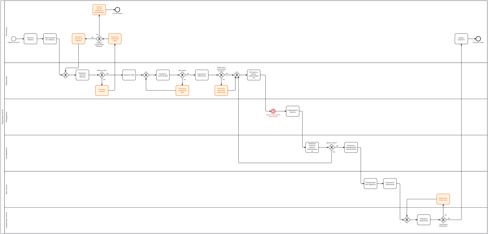
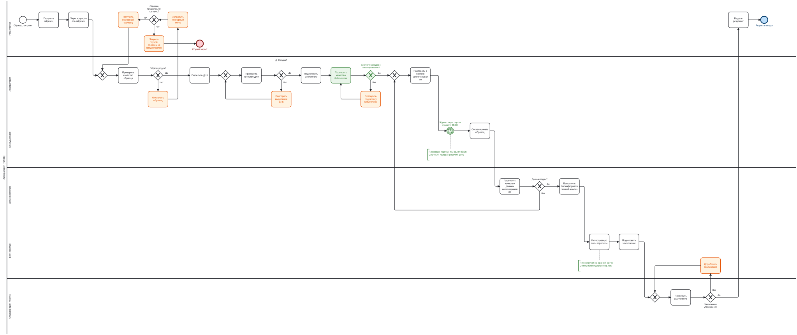

# Анализ и оптимизация процесса обработки образцов в генетической лаборатории

Учебный проект по бизнес-анализу и процессному управлению: описание процесса в BPMN, схема процесса (AS-IS), анализ журнала событий в SQL, поиск узких мест, предложения по улучшению, оценка эффекта на сценариях, новая схема процесса (TO-BE) и регламент.

> **Данные синтетические.** Они сгенерированы скриптом `scripts/generate_event_log.py`. Реальные данные лабораторий не использовались, проект не описывает конкретную компанию. Узкие места заложены в генератор намеренно, цель проекта показать метод анализа.

## Результат кратко

- Средний срок от приёма образца до результата **13,3 дня**, из них **8,8 дня (66%)** образец ждёт.
- Два узких места дают **68% всего ожидания**: партии секвенирования раз в неделю (4,3 дня на случай) и очередь к врачам-генетикам (1,8 дня).
- Расчёт сценариев показывает: партии 3 раза в неделю плюс контроль качества библиотеки сокращают средний срок **с 13,3 до 10,2 дня (-24%)**, P90 с 18,8 до 13,0 дня.
- Седьмой врач даёт лишь -0,5 дня: изменение расписания эффективнее найма.

## Схемы процесса

### AS-IS (как сейчас)



### TO-BE (после улучшений): изменения выделены зелёным



## Что сделано

| Этап | Результат | Файлы |
| --- | --- | --- |
| 1. Данные | Синтетический журнал событий (1500 случаев, 21 698 событий) | `data/`, `scripts/generate_event_log.py` |
| 2. Схема AS-IS | BPMN, 6 дорожек | `diagrams/as_is.bpmn` |
| 3. Анализ в SQL | Сроки, ожидание по этапам, повторы, очереди | `sql/analysis.sql`, `analysis/lab.db` |
| 4. Выводы | Три проблемы с цифрами | [analysis/findings.md](analysis/findings.md) |
| 5. Предложения | Таблица «проблема, причина, предложение, эффект, риски» | [docs/improvements.md](docs/improvements.md) |
| 6. Оценка эффекта | 8 сценариев на одном потоке образцов | [analysis/scenario_results.md](analysis/scenario_results.md), [sql/scenarios.sql](sql/scenarios.sql), [analysis/scenarios.db](analysis/scenarios.db) |
| 7. Схема TO-BE | BPMN с изменениями | `diagrams/to_be.bpmn` |
| 8. Регламент | Формирование партий и контроль качества библиотеки, чек-лист | [docs/regulation_sequencing_batches.md](docs/regulation_sequencing_batches.md), [docs/checklist_batch_enqueue.md](docs/checklist_batch_enqueue.md) |

## Ключевые выводы анализа AS-IS

1. **Ожидание партии секвенирования:** в среднем 4,3 дня, 48% всего ожидания. Плановые образцы ждут 4,4 дня, срочные 2,0 дня.
2. **Очередь к врачам:** в среднем 1,8 дня, 63,5% образцов приходят в среду волной после партии.
3. **Повторы и брак:** у 22% случаев, срок такого случая больше на 3,0 дня, пересеквенирование на 6,9 дня.

Подробно: [analysis/findings.md](analysis/findings.md).

## Оценка эффекта

| Сценарий | Средний срок, дни | Изменение |
| --- | --- | --- |
| S0. Как сейчас | 13,3 | |
| S1. Партии 2 раза в неделю | 11,2 | -2,2 |
| S2. Партии 3 раза в неделю, срочные ежедневно | 10,2 | -3,1 |
| S3. Партии ежедневно | 9,6 | -3,7 |
| S4. Седьмой врач | 12,8 | -0,5 |
| S6. S2 плюс контроль качества библиотеки | 10,2 | -3,2 |
| S7. Ежедневные партии при 5 врачах (проверка риска) | 15,6 | +2,3 |

Подробно, включая проверку устойчивости на 10 запусках: [analysis/scenario_results.md](analysis/scenario_results.md).

## Как воспроизвести

```bash
python scripts/generate_event_log.py --cases 1500 --seed 42 --out data
python scripts/run_scenarios.py
```

SQL-запросы выполняются в любой программе для SQLite (например, DB Browser for SQLite) на базах `analysis/lab.db` и `analysis/scenarios.db`. Скрипты используют только стандартную библиотеку Python 3.8+.

## Структура репозитория

```text
├── README.md
├── data/          журнал событий (CSV), версия для Excel, словарь данных
├── scripts/       генератор данных и запуск сценариев
├── diagrams/      схемы AS-IS и TO-BE (.bpmn и изображения)
├── sql/           analysis.sql, scenarios.sql
├── analysis/      базы SQLite, выводы, результаты сценариев
└── docs/          предложения по улучшению, регламент, чек-лист
```

## Как использовался ИИ

Для подготовки проекта использовался ИИ-ассистент: скрипт генерации синтетических данных и запуска сценариев, шаблоны SQL-запросов и черновики документов подготовлены с его помощью. Схемы BPMN, выполнение запросов, интерпретация результатов и итоговые формулировки выводов проверены и доработаны мною.

## Ограничения

- Данные синтетические, параметры модели заданы автором.
- Ожидание измерено в календарных часах (ночи и выходные входят в ожидание).
- Стоимость запусков секвенатора не моделируется.
- Причинные связи подтверждены только на модели, в реальной лаборатории предложения нужно проверять пилотом.

## Автор

[Julia Kovaleva], [Telegram: julensas, email: julensaas16@gmail.com]
